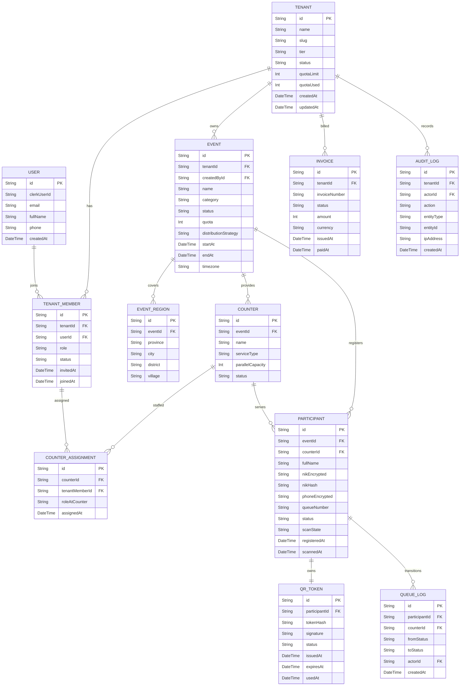

> **Archived long-term vision, not the v1 contract.** v1 is deliberately smaller (one organization, one event, one VPS). The current docs live at the repo root and in `docs/adr/`. Decisions here may be superseded for v1. Links to sibling files that do not exist (REQUIREMENTS, USER_FLOW, BUSINESS_RULES, ARCHITECTURE, ROADMAP) were never written.

# DATABASE.md: AntriAja

## 1. Ruang Lingkup Dokumen

Dokumen ini mendefinisikan model data AntriAja: ERD, definisi tabel lengkap dengan kolom, tipe, constraint, dan index, serta Prisma Schema yang siap dipakai. Dokumen ini **tidak** memuat definisi endpoint REST (lihat `API.md`), aturan bisnis tingkat fitur (lihat `FEATURES.md`), atau keputusan arsitektur runtime (lihat `ARCHITECTURE.md`). Setiap nilai yang belum eksplisit ditandai `TBD` sesuai SPEC-DRIVEN CONTRACT.

Prinsip desain data:

- **Isolasi multi-tenant**: setiap entitas operasional membawa `tenantId` sebagai kolom wajib dan filter utama pada seluruh query (DEC-007, FR-12).
- **Idempotensi QR sekali scan**: dijamin pada level database melalui kolom `scanState` dengan unique index parsial dan transaksi `SELECT ... FOR UPDATE` (DEC-004).
- **Skala 50.000 peserta/event**: index komposit dan agregasi ter-denormalisasi disiapkan untuk menjaga query dashboard < 2 detik (DEC-006).
- **Audit immutable**: tabel `AuditLog` bersifat append-only tanpa operasi `UPDATE`/`DELETE` (FR-18).

---

## 2. Entity Relationship Diagram



---

## 3. Definisi Tabel

### 3.1 Tenant

Menyimpan organisasi/penyelenggara beserta status paket dan kuota agregat. Sumber kebenaran untuk penegakan tier (DEC-001, DEC-002, FR-13, FR-15).

| Kolom | Tipe | Constraint | Keterangan |
|:---|:---|:---|:---|
| id | String (cuid) | PK | Identifier tenant |
| name | String | NOT NULL | Nama organisasi |
| slug | String | UNIQUE, NOT NULL | Slug URL publik |
| tier | String | NOT NULL, DEFAULT `FREE` | `FREE`, `SMALL`, `MEDIUM`, `LARGE` (ambang TBD) |
| status | String | NOT NULL, DEFAULT `ACTIVE` | `ACTIVE`, `SUSPENDED`, `DELETED` |
| quotaLimit | Int | NOT NULL, DEFAULT 1000 | Batas peserta agregat sesuai tier |
| quotaUsed | Int | NOT NULL, DEFAULT 0 | Peserta terpakai (dikembalikan saat event `CANCELLED`) |
| createdAt | DateTime | NOT NULL, DEFAULT now() | |
| updatedAt | DateTime | NOT NULL, @updatedAt | |

Index: `@@unique([slug])`, `@@index([status])`.

Aturan: kuota tidak boleh negatif (`quotaUsed >= 0`); downgrade tier dengan `quotaUsed > quotaLimit` baru ditolak `ERR-BILL-001`.

### 3.2 User

Identitas global pengguna yang dipetakan ke Clerk. Satu user dapat menjadi anggota beberapa tenant (FR-12).

| Kolom | Tipe | Constraint | Keterangan |
|:---|:---|:---|:---|
| id | String (cuid) | PK | |
| clerkUserId | String | UNIQUE, NOT NULL | ID dari Clerk v6 |
| email | String | UNIQUE, NOT NULL | |
| fullName | String | NOT NULL | |
| phone | String | NULL | Format Indonesia |
| createdAt | DateTime | NOT NULL, DEFAULT now() | |

Index: `@@unique([clerkUserId])`, `@@unique([email])`.

### 3.3 TenantMember

Tabel pivot peran user di dalam tenant. Menegakkan DEC-007 (multi-admin: `OWNER`, `ADMIN_EVENT`, `SUPERVISOR`, `VERIFIER`, `COUNTER_OPERATOR`).

| Kolom | Tipe | Constraint | Keterangan |
|:---|:---|:---|:---|
| id | String (cuid) | PK | |
| tenantId | String | FK → Tenant.id, NOT NULL | |
| userId | String | FK → User.id, NOT NULL | |
| role | String | NOT NULL | `OWNER`, `ADMIN_EVENT`, `SUPERVISOR`, `VERIFIER`, `COUNTER_OPERATOR` |
| status | String | NOT NULL, DEFAULT `INVITED` | `INVITED`, `ACTIVE`, `REVOKED` |
| invitedAt | DateTime | NOT NULL, DEFAULT now() | |
| joinedAt | DateTime | NULL | |

Index: `@@unique([tenantId, userId])`, `@@index([tenantId, role])`, `@@index([userId])`.

Aturan: minimal satu `OWNER` per tenant; penghapusan owner terakhir ditolak (FR-11).

### 3.4 Event

Entitas inti acara. Menyimpan konfigurasi kuota, strategi distribusi loket (DEC-005), dan status siklus hidup (FR-01).

| Kolom | Tipe | Constraint | Keterangan |
|:---|:---|:---|:---|
| id | String (cuid) | PK | |
| tenantId | String | FK → Tenant.id, NOT NULL | |
| createdById | String | FK → User.id, NOT NULL | |
| name | String | NOT NULL | |
| category | String | NOT NULL | `SOSIAL`, `UMKM`, `INSTANSI` |
| status | String | NOT NULL, DEFAULT `DRAFT` | `DRAFT`, `PUBLISHED`, `PAUSED`, `COMPLETED`, `CANCELLED` |
| quota | Int | NOT NULL, CHECK (quota >= 1) | `ERR-EV-001` jika < 1 |
| distributionStrategy | String | NOT NULL, DEFAULT `LEAST_LOADED` | `LEAST_LOADED`, `ROUND_ROBIN` |
| startAt | DateTime | NOT NULL | |
| endAt | DateTime | NOT NULL | CHECK (endAt > startAt) → `ERR-EV-002` |
| timezone | String | NOT NULL, DEFAULT `Asia/Jakarta` | |
| publicToken | String | UNIQUE, NULL | Token akses papan antrian event private |
| createdAt | DateTime | NOT NULL, DEFAULT now() | |
| updatedAt | DateTime | NOT NULL, @updatedAt | |

Index: `@@index([tenantId, status])`, `@@index([startAt])`, `@@unique([publicToken])`.

Aturan: event `PUBLISHED` tidak dapat dihapus, hanya `CANCELLED`; pembuatan event memeriksa `quota` terhadap `Tenant.quotaLimit` → `ERR-BILL-001`.

### 3.5 EventRegion

Wilayah cakupan administratif event (FR-02). Jika event tidak memiliki baris di tabel ini, event bersifat publik nasional.

| Kolom | Tipe | Constraint | Keterangan |
|:---|:---|:---|:---|
| id | String (cuid) | PK | |
| eventId | String | FK → Event.id, NOT NULL | |
| province | String | NOT NULL | |
| city | String | NULL | |
| district | String | NULL | |
| village | String | NULL | |

Index: `@@index([eventId])`, `@@index([province, city])`.

### 3.6 Counter

Loket layanan per event (FR-03). Menyimpan kapasitas paralel dan status operasional.

| Kolom | Tipe | Constraint | Keterangan |
|:---|:---|:---|:---|
| id | String (cuid) | PK | |
| eventId | String | FK → Event.id, NOT NULL | |
| name | String | NOT NULL | |
| serviceType | String | NULL | Jenis layanan |
| parallelCapacity | Int | NOT NULL, DEFAULT 1 | Kapasitas paralel maksimal |
| status | String | NOT NULL, DEFAULT `ACTIVE` | `ACTIVE`, `INACTIVE`, `IDLE` |
| currentServing | String | NULL | participantId yang sedang dilayani |
| createdAt | DateTime | NOT NULL, DEFAULT now() | |

Index: `@@unique([eventId, name])`, `@@index([eventId, status])`.

Aturan: loket tanpa petugas aktif otomatis `INACTIVE` dan tidak menerima antrian baru (FR-03).

### 3.7 CounterAssignment

Penugasan petugas ke loket (FR-03, DEC-007). Satu petugas dapat ditugaskan ke beberapa loket.

| Kolom | Tipe | Constraint | Keterangan |
|:---|:---|:---|:---|
| id | String (cuid) | PK | |
| counterId | String | FK → Counter.id, NOT NULL | |
| tenantMemberId | String | FK → TenantMember.id, NOT NULL | |
| roleAtCounter | String | NOT NULL | `VERIFIER`, `COUNTER_OPERATOR`, `SUPERVISOR` |
| assignedAt | DateTime | NOT NULL, DEFAULT now() | |
| revokedAt | DateTime | NULL | Soft revoke; riwayat audit dipertahankan |

Index: `@@unique([counterId, tenantMemberId])`, `@@index([tenantMemberId])`.

### 3.8 Participant

Peserta terdaftar per event. Data pribadi dienkripsi AES-256 at rest; `nikHash` untuk deteksi duplikat (DEC-004, FR-05, FR-18).

| Kolom | Tipe | Constraint | Keterangan |
|:---|:---|:---|:---|
| id | String (cuid) | PK | |
| eventId | String | FK → Event.id, NOT NULL | |
| counterId | String | FK → Counter.id, NULL | Diisi saat distribusi otomatis |
| fullName | String | NOT NULL | |
| nikEncrypted | String | NOT NULL | AES-256 ciphertext |
| nikHash | String | NOT NULL | SHA-256 untuk deteksi duplikat |
| phoneEncrypted | String | NOT NULL | AES-256 ciphertext |
| phoneHash | String | NULL | Untuk lookup terkontrol |
| regionProvince | String | NULL | Hasil input domisili |
| regionCity | String | NULL | |
| regionDistrict | String | NULL | |
| regionVillage | String | NULL | |
| queueNumber | String | NOT NULL | Nomor antrian berurutan per event |
| status | String | NOT NULL, DEFAULT `WAITING` | `WAITING`, `CALLED`, `SERVING`, `DONE`, `NO_SHOW`, `CANCELLED` |
| scanState | String | NOT NULL, DEFAULT `UNSCANNED` | `UNSCANNED`, `VERIFIED` |
| callCount | Int | NOT NULL, DEFAULT 0 | Threshold `NO_SHOW` = 3 (TBD) |
| registeredAt | DateTime | NOT NULL, DEFAULT now() | |
| scannedAt | DateTime | NULL | |
| updatedAt | DateTime | NOT NULL, @updatedAt | |

Index: `@@unique([eventId, nikHash])` (cegah `ERR-REG-003`), `@@unique([eventId, queueNumber])`, `@@index([eventId, status])`, `@@index([counterId, status])`, `@@index([eventId, scanState])`.

Aturan: `status = CANCELLED` tidak dapat divalidasi (FR-07); `scanState = VERIFIED` bersifat final (idempotensi QR).

### 3.9 QrToken

Token QR sekali scan per peserta (DEC-004, FR-06). Menyimpan hash token dan signature JWT.

| Kolom | Tipe | Constraint | Keterangan |
|:---|:---|:---|:---|
| id | String (cuid) | PK | |
| participantId | String | FK → Participant.id, UNIQUE, NOT NULL | Relasi 1:1 |
| tokenHash | String | UNIQUE, NOT NULL | SHA-256 payload QR |
| signature | String | NOT NULL | HMAC/JWT signature |
| status | String | NOT NULL, DEFAULT `ACTIVE` | `ACTIVE`, `USED`, `EXPIRED`, `REVOKED` |
| issuedAt | DateTime | NOT NULL, DEFAULT now() | |
| expiresAt | DateTime | NOT NULL | Mengikuti `Event.endAt` → `ERR-QR-001` |
| usedAt | DateTime | NULL | |

Index: `@@unique([tokenHash])`, `@@index([status])`.

Aturan: transisi `ACTIVE → USED` terjadi atomik; percobaan kedua mengembalikan `ERR-QR-002`.

### 3.10 QueueLog

Riwayat transisi status peserta (FR-07). Sumber data untuk metrik waktu tunggu dan throughput (FR-10).

| Kolom | Tipe | Constraint | Keterangan |
|:---|:---|:---|:---|
| id | String (cuid) | PK | |
| participantId | String | FK → Participant.id, NOT NULL | |
| counterId | String | FK → Counter.id, NULL | |
| fromStatus | String | NULL | |
| toStatus | String | NOT NULL | |
| actorId | String | FK → User.id, NULL | NULL jika transisi otomatis sistem |
| createdAt | DateTime | NOT NULL, DEFAULT now() | |

Index: `@@index([participantId, createdAt])`, `@@index([counterId, createdAt])`, `@@index([toStatus])`.

### 3.11 AuditLog

Log append-only untuk aksi kritis (FR-18). Tidak ada operasi `UPDATE`/`DELETE`.

| Kolom | Tipe | Constraint | Keterangan |
|:---|:---|:---|:---|
| id | String (cuid) | PK | |
| tenantId | String | FK → Tenant.id, NOT NULL | |
| actorId | String | FK → User.id, NULL | NULL untuk aksi sistem |
| action | String | NOT NULL | `LOGIN`, `EVENT_CREATE`, `QR_SCAN`, `QUEUE_CALL`, `SECURITY_WARN`, dll |
| entityType | String | NOT NULL | Nama entitas terkait |
| entityId | String | NULL | |
| ipAddress | String | NULL | |
| metadata | Json | NULL | Detail tambahan |
| createdAt | DateTime | NOT NULL, DEFAULT now() | |

Index: `@@index([tenantId, createdAt])`, `@@index([action])`, `@@index([actorId])`.

### 3.12 Invoice

Tagihan untuk upgrade paket atau pembelian add-on (FR-14).

| Kolom | Tipe | Constraint | Keterangan |
|:---|:---|:---|:---|
| id | String (cuid) | PK | |
| tenantId | String | FK → Tenant.id, NOT NULL | |
| invoiceNumber | String | UNIQUE, NOT NULL | |
| status | String | NOT NULL, DEFAULT `PENDING` | `PENDING`, `PAID`, `FAILED`, `EXPIRED` |
| amount | Int | NOT NULL | Dalam satuan terkecil (rupiah) |
| currency | String | NOT NULL, DEFAULT `IDR` | |
| description | String | NULL | |
| issuedAt | DateTime | NOT NULL, DEFAULT now() | |
| paidAt | DateTime | NULL | |

Index: `@@unique([invoiceNumber])`, `@@index([tenantId, status])`.

---

## 4. Prisma Schema

```prisma
generator client {
  provider = "prisma-client-js"
}

datasource db {
  provider = "postgresql"
  url      = env("DATABASE_URL")
}

model Tenant {
  id          String   @id @default(cuid())
  name        String
  slug        String   @unique
  tier        String   @default("FREE")
  status      String   @default("ACTIVE")
  quotaLimit  Int      @default(1000)
  quotaUsed   Int      @default(0)
  createdAt   DateTime @default(now())
  updatedAt   DateTime @updatedAt

  members  TenantMember[]
  events   Event[]
  invoices Invoice[]
  auditLogs AuditLog[]

  @@index([status])
}

model User {
  id          String   @id @default(cuid())
  clerkUserId String   @unique
  email       String   @unique
  fullName    String
  phone       String?
  createdAt   DateTime @default(now())

  memberships       TenantMember[]
  createdEvents     Event[]
  queueLogs         QueueLog[]
  auditLogs         AuditLog[]
}

model TenantMember {
  id        String    @id @default(cuid())
  tenantId  String
  userId    String
  role      String
  status    String    @default("INVITED")
  invitedAt DateTime  @default(now())
  joinedAt  DateTime?

  tenant      Tenant             @relation(fields: [tenantId], references: [id], onDelete: Cascade)
  user        User               @relation(fields: [userId], references: [id], onDelete: Cascade)
  assignments CounterAssignment[]

  @@unique([tenantId, userId])
  @@index([tenantId, role])
  @@index([userId])
}

model Event {
  id                   String   @id @default(cuid())
  tenantId             String
  createdById          String
  name                 String
  category             String
  status               String   @default("DRAFT")
  quota                Int
  distributionStrategy String   @default("LEAST_LOADED")
  startAt              DateTime
  endAt                DateTime
  timezone             String   @default("Asia/Jakarta")
  publicToken          String?  @unique
  createdAt            DateTime @default(now())
  updatedAt            DateTime @updatedAt

  tenant       Tenant        @relation(fields: [tenantId], references: [id], onDelete: Cascade)
  createdBy    User          @relation(fields: [createdById], references: [id])
  regions      EventRegion[]
  counters     Counter[]
  participants Participant[]

  @@index([tenantId, status])
  @@index([startAt])
}

model EventRegion {
  id       String  @id @default(cuid())
  eventId  String
  province String
  city     String?
  district String?
  village  String?

  event Event @relation(fields: [eventId], references: [id], onDelete: Cascade)

  @@index([eventId])
  @@index([province, city])
}

model Counter {
  id               String   @id @default(cuid())
  eventId          String
  name             String
  serviceType      String?
  parallelCapacity Int      @default(1)
  status           String   @default("ACTIVE")
  currentServing   String?
  createdAt        DateTime @default(now())

  event       Event               @relation(fields: [eventId], references: [id], onDelete: Cascade)
  assignments CounterAssignment[]
  participants Participant[]
  queueLogs   QueueLog[]

  @@unique([eventId, name])
  @@index([eventId, status])
}

model CounterAssignment {
  id             String    @id @default(cuid())
  counterId      String
  tenantMemberId String
  roleAtCounter  String
  assignedAt     DateTime  @default(now())
  revokedAt      DateTime?

  counter      Counter      @relation(fields: [counterId], references: [id], onDelete: Cascade)
  tenantMember TenantMember @relation(fields: [tenantMemberId], references: [id], onDelete: Cascade)

  @@unique([counterId, tenantMemberId])
  @@index([tenantMemberId])
}

model Participant {
  id             String    @id @default(cuid())
  eventId        String
  counterId      String?
  fullName       String
  nikEncrypted   String
  nikHash        String
  phoneEncrypted String
  phoneHash      String?
  regionProvince String?
  regionCity     String?
  regionDistrict String?
  regionVillage  String?
  queueNumber    String
  status         String    @default("WAITING")
  scanState      String    @default("UNSCANNED")
  callCount      Int       @default(0)
  registeredAt   DateTime  @default(now())
  scannedAt      DateTime?
  updatedAt      DateTime  @updatedAt

  event     Event      @relation(fields: [eventId], references: [id], onDelete: Cascade)
  counter   Counter?   @relation(fields: [counterId], references: [id])
  qrToken   QrToken?
  queueLogs QueueLog[]

  @@unique([eventId, nikHash])
  @@unique([eventId, queueNumber])
  @@index([eventId, status])
  @@index([counterId, status])
  @@index([eventId, scanState])
}

model QrToken {
  id            String    @id @default(cuid())
  participantId String    @unique
  tokenHash     String    @unique
  signature     String
  status        String    @default("ACTIVE")
  issuedAt      DateTime  @default(now())
  expiresAt     DateTime
  usedAt        DateTime?

  participant Participant @relation(fields: [participantId], references: [id], onDelete: Cascade)

  @@index([status])
}

model QueueLog {
  id            String   @id @default(cuid())
  participantId String
  counterId     String?
  fromStatus    String?
  toStatus      String
  actorId       String?
  createdAt     DateTime @default(now())

  participant Participant @relation(fields: [participantId], references: [id], onDelete: Cascade)
  counter     Counter?    @relation(fields: [counterId], references: [id])
  actor       User?       @relation(fields: [actorId], references: [id])

  @@index([participantId, createdAt])
  @@index([counterId, createdAt])
  @@index([toStatus])
}

model AuditLog {
  id         String   @id @default(cuid())
  tenantId   String
  actorId    String?
  action     String
  entityType String
  entityId   String?
  ipAddress  String?
  metadata   Json?
  createdAt  DateTime @default(now())

  tenant Tenant @relation(fields: [tenantId], references: [id], onDelete: Cascade)
  actor  User?  @relation(fields: [actorId], references: [id])

  @@index([tenantId, createdAt])
  @@index([action])
  @@index([actorId])
}

model Invoice {
  id            String    @id @default(cuid())
  tenantId      String
  invoiceNumber String    @unique
  status        String    @default("PENDING")
  amount        Int
  currency      String    @default("IDR")
  description   String?
  issuedAt      DateTime  @default(now())
  paidAt        DateTime?

  tenant Tenant @relation(fields: [tenantId], references: [id], onDelete: Cascade)

  @@index([tenantId, status])
}
```

---

## 5. Partial Index & Raw SQL Migration

Prisma tidak mendukung partial unique index melalui `@@unique(..., where: [...])`. Constraint berikut **MUST** diterapkan melalui raw SQL migration. Index ini menjamin idempotensi QR sekali scan (DEC-004) dan mencegah dua peserta aktif dengan nomor antrian yang sama.

```sql
-- Satu token QR hanya boleh memiliki satu baris USED aktif per peserta.
-- Mencegah double-scan walaupun ada race condition pada level aplikasi.
CREATE UNIQUE INDEX "qr_token_active_unique"
  ON "QrToken" ("participantId")
  WHERE "status" = 'ACTIVE';

-- Nomor antrian unik hanya untuk peserta yang tidak dibatalkan.
-- Peserta CANCELLED boleh memiliki nomor yang nantinya dapat dipakai ulang (TBD).
CREATE UNIQUE INDEX "participant_active_queue_unique"
  ON "Participant" ("eventId", "queueNumber")
  WHERE "status" <> 'CANCELLED';

-- Mempercepat agregasi dashboard (FR-10) pada event skala besar.
CREATE INDEX "participant_event_status_idx"
  ON "Participant" ("eventId", "status")
  INCLUDE ("counterId", "scannedAt");

-- Mempercepat pengambilan antrian berikutnya pada loket dengan strategi LEAST_LOADED.
CREATE INDEX "participant_counter_waiting_idx"
  ON "Participant" ("counterId", "status")
  WHERE "status" IN ('WAITING', 'CALLED');
```

---

## 6. Strategi Transaksi Kritis

### 6.1 Scan QR Sekali Scan (Idempotensi Exactly-Once)

Operasi scan **MUST** berjalan dalam satu transaksi Serializable untuk menjamin hanya satu scan yang berhasil (DEC-004, NFR Reliabilitas).

```sql
BEGIN;
SET TRANSACTION ISOLATION LEVEL SERIALIZABLE;

SELECT id, status, "expiresAt"
FROM "QrToken"
WHERE "tokenHash" = $1
FOR UPDATE;

-- Jika status <> 'ACTIVE' → ERR-QR-002 (already used) atau ERR-QR-001 (expired)
UPDATE "QrToken"
SET status = 'USED', "usedAt" = now()
WHERE "tokenHash" = $1 AND status = 'ACTIVE';

UPDATE "Participant"
SET "scanState" = 'VERIFIED', status = 'WAITING', "scannedAt" = now()
WHERE id = $2 AND "scanState" = 'UNSCANNED';

INSERT INTO "QueueLog" ("id", "participantId", "fromStatus", "toStatus", "actorId", "createdAt")
VALUES (gen_random_uuid(), $2, 'UNSCANNED', 'VERIFIED', $3, now());

COMMIT;
```

Jika baris `UPDATE` kedua mengembalikan 0 baris (karena `scanState` sudah `VERIFIED`), transaksi di-rollback dan API mengembalikan `ERR-QR-002`.

### 6.2 Distribusi Antrian Otomatis (LEAST_LOADED)

Pemilihan loket **MUST** memakai locking untuk mencegah dua peserta masuk ke loket yang sama secara bersamaan (DEC-005).

```sql
SELECT c.id, COUNT(p.id) AS load
FROM "Counter" c
LEFT JOIN "Participant" p
  ON p."counterId" = c.id AND p.status IN ('WAITING', 'CALLED')
WHERE c."eventId" = $1 AND c.status = 'ACTIVE'
GROUP BY c.id
ORDER BY load ASC, c.id ASC
LIMIT 1
FOR UPDATE OF c SKIP LOCKED;
```

Strategi `ROUND_ROBIN` menggunakan kolom `currentServing` pada `Counter` sebagai penanda giliran terakhir.

### 6.3 Pengembalian Kuota Event CANCELLED

Saat event diubah ke `CANCELLED`, kuota tenant dikembalikan dalam satu transaksi (FR-15).

```sql
BEGIN;
UPDATE "Event" SET status = 'CANCELLED' WHERE id = $1 AND status <> 'CANCELLED';
UPDATE "Tenant"
SET "quotaUsed" = GREATEST("quotaUsed" - $2, 0)
WHERE id = $3;
COMMIT;
```

---

## 7. Enkripsi & Masking Data Pribadi

Data pribadi peserta (NIK, nomor HP) dienkripsi menggunakan AES-256-GCM sebelum disimpan (FR-18, NFR Keamanan).

| Kolom | Perlakuan | Keterangan |
|:---|:---|:---|
| nikEncrypted | AES-256-GCM | IV disimpan sebagai prefix ciphertext |
| nikHash | SHA-256 + tenant pepper | Untuk deteksi duplikat tanpa dekripsi |
| phoneEncrypted | AES-256-GCM | |
| phoneHash | SHA-256 + tenant pepper | Untuk lookup terkontrol |

Aturan masking UI (FR-19):

- NIK ditampilkan 6 digit terakhir untuk non-Owner: `****-****-****-1234`.
- Nomor HP ditampilkan `+62 8xx-xxxx-5678`.
- Kolom `nikEncrypted` dan `phoneEncrypted` **MUST NOT** dikembalikan pada endpoint list; hanya melalui endpoint detail dengan audit log.

---

## 8. Catatan Konsistensi & Nilai TBD

| Item | Status | Catatan |
|:---|:---|:---|
| Ambang peserta per tier (FREE/SMALL/MEDIUM/LARGE) | TBD | DEC-002; `quotaLimit` default 1000 untuk FREE |
| Nomor antrian per event atau per loket | TBD | FR-07; skema mendukung keduanya via `queueNumber` + `counterId` |
| Threshold `NO_SHOW` (jumlah panggilan) | TBD | Default implementasi 3 pada `callCount` |
| Batas import CSV (baris & ukuran) | TBD | FR-16; tidak memengaruhi skema |
| Kebijakan retensi data tenant `DELETED` | TBD | FR-12 |
| Integrasi Dukcapil untuk validasi NIK | TBD | FR-02; skema hanya menyimpan format |
| Field tambahan formulir per event | TBD | FR-05; disimpan sebagai `metadata` Json bila diperlukan |

Semua nilai TBD di atas **MUST NOT** diasumsikan pada implementasi hingga ditetapkan melalui `DECISIONS.md` atau dokumen turunan resmi.